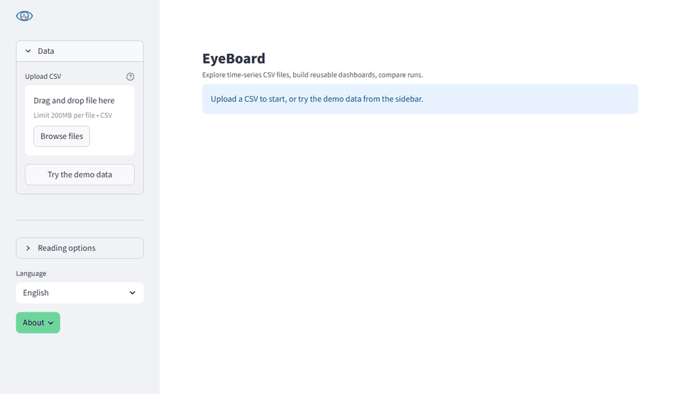
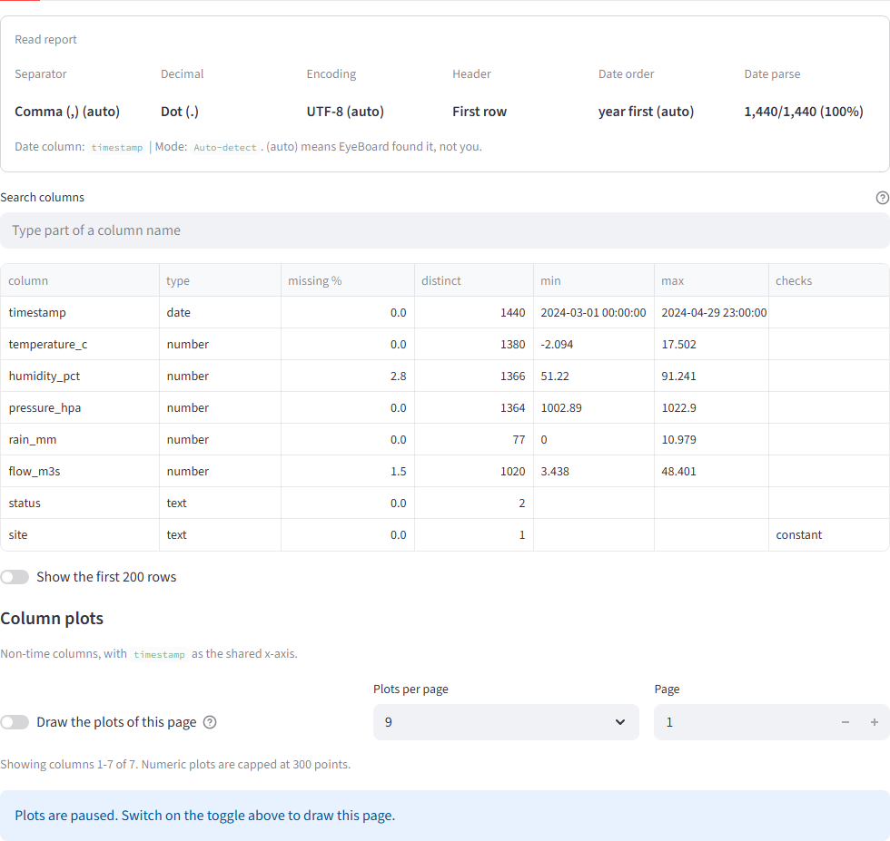
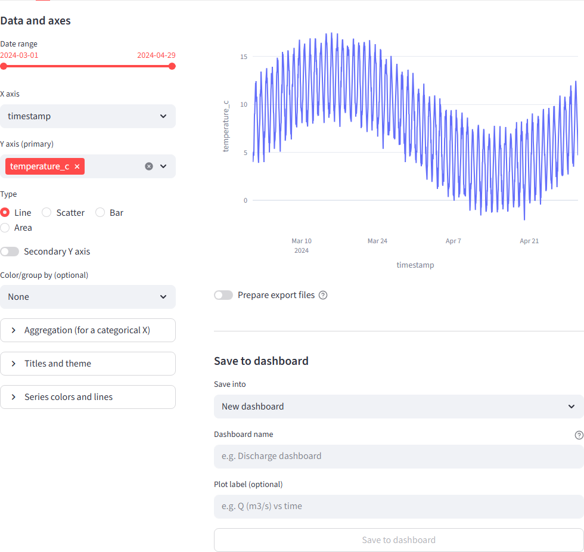
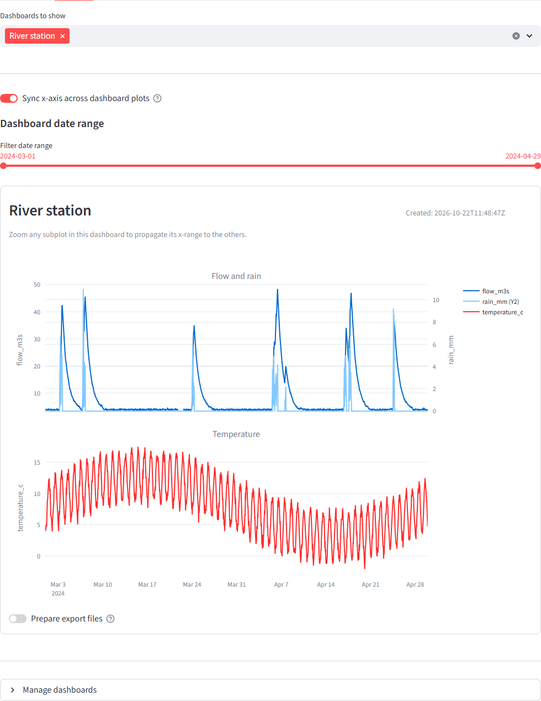
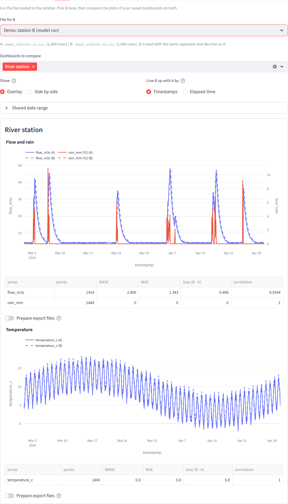

<h1> EyeBoard</h1>

**Open a time-series CSV, see what is really in it, plot it, and compare it with another run.**



EyeBoard is a small app that runs on your own computer. You give it a CSV file (sensor readings, a simulation output, a log) and it helps you answer the first questions quickly. Did it read the file the way I think it did? Which columns are empty, constant or broken? What does the data look like? How does this run differ from that one?

Spreadsheets struggle with tens of thousands of rows and guess at your dates and decimals without telling you. A notebook gives full control, but you rewrite the same plotting code for every new file. EyeBoard sits in between: you look at a file, build the plots you care about once, and replay them on the next file.

## Try it in a minute

You need [uv](https://docs.astral.sh/uv/), a fast Python package manager that also fetches the right Python for you.

```bash
git clone https://github.com/flavienkohler/eyeboard
cd eyeboard
uv run eyeboard
```

The first start installs what it needs and opens EyeBoard in your browser. On Windows you can also double-click `run_app.bat`.

No file at hand? Click **Try the demo data** in the sidebar. It loads two months of a made-up weather and river station, and the Compare tab offers a second "model run" of the same period. The files are in [examples/](examples) if you prefer to upload them.

## What you can do

### Check a file before you trust it

The **Explore** tab starts with how the file was read, then lists every column: its type, how much is missing, how many distinct values it has, its range, and anything suspicious (a constant column, an empty one, numbers hiding in text, values written with a decimal comma). A search box filters the table and the small plot of each column.



### Build a plot, keep it

In the **Plot** tab the controls sit beside the figure, so you tune it while you watch it. Lines, scatter, bars and areas, a secondary Y axis, grouping by a column, aggregation, your own colors, a date range. When it looks right, save it into a dashboard.



### Replay it on any file

A dashboard is a named stack of plots that does not depend on a particular file. Open another CSV with the same kind of columns and the whole dashboard is redrawn on it, with a shared time axis you can zoom together. Reorder, edit and remove plots, or export a dashboard as JSON to share it.



### Compare two runs

The file you loaded is A; pick B. Every plot of your dashboards is drawn with B dashed over A, or side by side, and a table gives the RMSE, MAE, bias and correlation for each series. B can be lined up with A on the same timestamps, or from each file's own start when two runs began at different times.



## It tells you what it guessed

Automatic detection is convenient and sometimes wrong, so EyeBoard shows its decisions instead of hiding them. The read report and the sidebar list the separator, decimal, encoding, header and date order, and mark with `(auto)` the ones it found on its own. A banner warns when numbers look written with a decimal comma but are read as text, and values that cannot be converted are reported, never silently dropped.

## Take your results with you

Under each chart, *Prepare export files* gives a standalone HTML page of the chart (it opens offline and keeps the zoom), and the plotted data or the comparison metrics as CSV. For a PNG, use the camera icon in the chart's toolbar.

## Your files stay on your machine

Nothing is uploaded anywhere, no usage statistics are sent, and the app only listens on your own machine (`--server.address 0.0.0.0` opens it to the network if you ever want that). EyeBoard keeps your saved dashboards (`dashboards.json`) and copies of the files you opened (for the recent list) in one folder: `%APPDATA%/eyeboard` on Windows, the standard per-user data folder elsewhere, or the folder named by the `EYEBOARD_HOME` environment variable. The sidebar shows the exact location and can clear the recent files.

The interface is available in English and French (selector at the bottom of the sidebar). Python 3.11 to 3.13 is supported.

## Feedback

EyeBoard is young, and real files are the best test. If something reads wrongly, breaks, or is missing for your data, please [open an issue](https://github.com/flavienkohler/eyeboard/issues/new/choose): there is a short form for bugs and one for ideas. Anonymised sample lines of the file you struggled with are the most useful thing you can add.

## License

EyeBoard is licensed under the [PolyForm Noncommercial License 1.0.0](LICENSE). You are free to use, study and modify it for any noncommercial purpose, provided the copyright notice and license terms stay with it. Commercial use requires the author's permission.

If you use or present this work, please cite it (see [CITATION.cff](CITATION.cff); GitHub shows a "Cite this repository" button).

## AI assistance

Developed with the assistance of Claude (Anthropic) for code review and refactoring.
